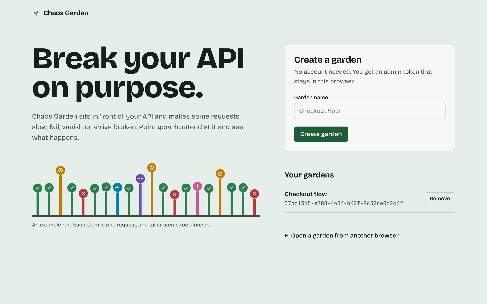
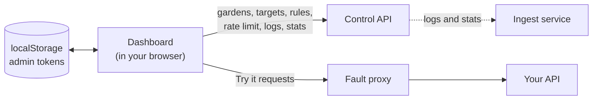
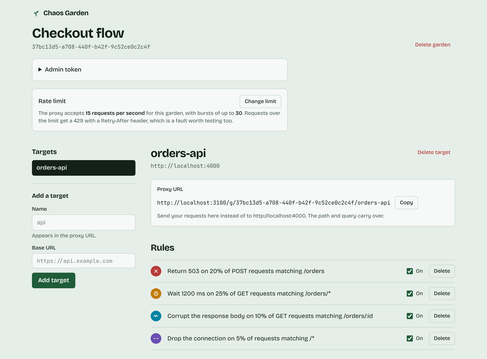
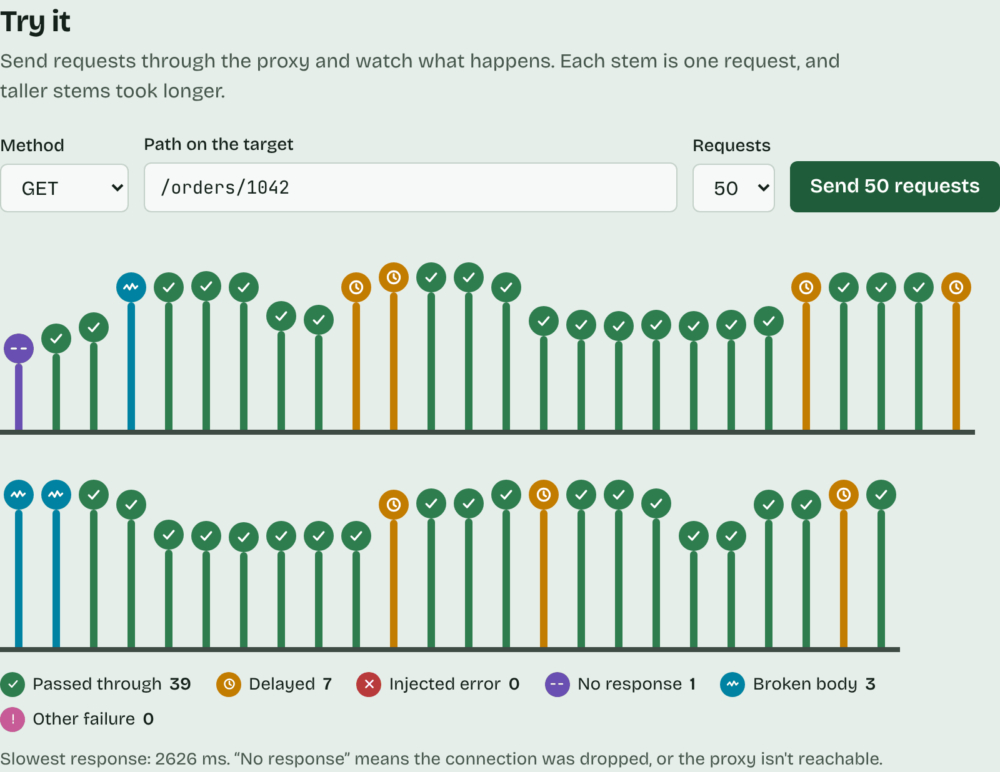
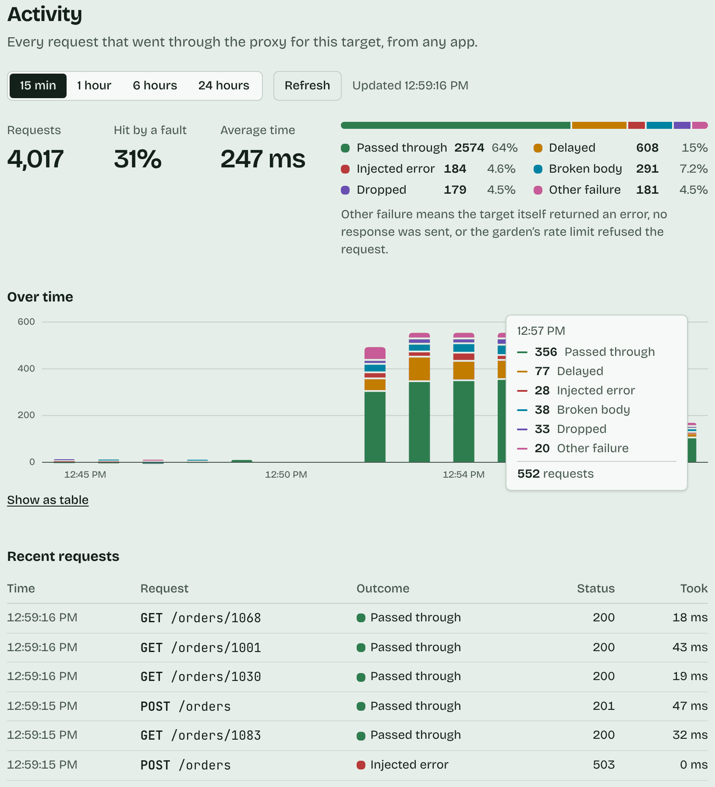

<div align="center">


# Chaos Garden: dashboard

**See how your app copes when the API misbehaves.** Create a garden, point it at an API, add rules that make requests slow, fail, vanish or come back broken, then send requests through the proxy and watch what happens.

[](https://github.com/georgi4334/chaos-garden-web/actions/workflows/ci.yml)




</div>

This is the web app of [Chaos Garden](https://github.com/georgi4334/Chaos-Garden). It runs in the browser and talks to two services directly:



- the [control API](https://github.com/georgi4334/Chaos-Garden) for gardens, targets, rules and the request logs;
- the [fault proxy](https://github.com/georgi4334/chaos-garden-proxy), which the "Try it" panel sends requests through.

## A quick tour

### Your garden



- **No accounts.** Creating a garden returns an admin token once. It is kept in this browser's `localStorage`, so clearing site data loses access unless you copied the token. Anyone with access to this browser profile can use it.
- **Targets** are the APIs you test. Each gets a proxy URL; send your app's requests there instead of to the API.
- **Rules** read as sentences and are listed in creation order. Turn them on and off without deleting them.
- **Rate limit.** Each garden has a proxy rate limit (requests per second and burst) that its owner can change. Requests over it get a 429, which Try it points out and Activity lists as "Rate limited".

### Try it



Send 10, 25 or 50 requests through the proxy from the page. Each request becomes a stem: the color and the shape on top show what happened, and the height shows how long it took, on a log scale. A request with no HTTP response at all shows as "No response": a dropped connection, or a proxy that can't be reached.

### Activity



Every request that went through the proxy for the selected target, from any app, not only Try it: request count, share hit by a fault, average time, the split by outcome, outcomes per minute, and the most recent requests. Hover the chart or use the arrow keys on it; "Show as table" lists the same numbers. It refreshes every 15 seconds and right after a Try it run. It needs the ingest service; if that is unavailable, this section says so and the rest of the page keeps working.

### Outcome colors


The six outcome colors were checked as one palette, for telling them apart with common kinds of color blindness and for contrast against the page. Each outcome also has its own shape (a tick, a clock, a cross, a wave, a dash, an exclamation mark), so color is never the only cue. If you change a color, re-run the palette check named in the comment in `src/app/globals.css`.

## Run it

Start the control API (port 3000) and the proxy (port 3100) first, as their READMEs describe, then:

```bash
npm install
cp .env.example .env.local
npm run dev        # http://localhost:3001
```

| Variable | Default | Meaning |
|---|---|---|
| `NEXT_PUBLIC_CONTROL_API_URL` | `http://localhost:3000` | control API base URL |
| `NEXT_PUBLIC_PROXY_URL` | `http://localhost:3100` | fault proxy base URL |

The control API only accepts browser calls from origins in its `CORS_ORIGIN` (default `http://localhost:3001`, this app's dev port).

To run everything, this app included, in containers instead, use `npm run stack:up` in the Chaos-Garden repo.

## Deploy on Vercel

Import this repository in Vercel and set `NEXT_PUBLIC_CONTROL_API_URL` and `NEXT_PUBLIC_PROXY_URL` to the public URLs of the control API and the proxy. These are compiled into the page, so redeploy after changing them. The full free setup (backend on Render, Postgres on Neon) is in Chaos-Garden's [DEPLOY.md](https://github.com/georgi4334/Chaos-Garden/blob/main/DEPLOY.md). On free hosting the APIs sleep when idle; the dashboard's error messages say when a server may be waking up.

## Docker and CI

```bash
docker build -t chaos-garden-web \
  --build-arg NEXT_PUBLIC_CONTROL_API_URL=http://localhost:3000 \
  --build-arg NEXT_PUBLIC_PROXY_URL=http://localhost:3100 .
docker run -p 3001:3001 chaos-garden-web
```

The API URLs are **build arguments**, because Next.js bakes `NEXT_PUBLIC_*` values into the browser bundle; they are the addresses the browser uses. The image uses Next.js standalone output (a small `server.js`), runs as `node` and has a health check.

On every pull request and on `main`, CI runs lint, the unit tests, the build and the browser tests, then builds the image. On `main` it pushes `ghcr.io/georgi4334/chaos-garden-web`, built for the local setup (APIs on localhost).

## Scripts and layout

```bash
npm run dev     # dev server on port 3001
npm run build   # production build
npm start       # serve the build on port 3001
npm run lint
npm test          # unit and component tests (Vitest, Testing Library)
npm run test:e2e  # browser tests (Playwright): run `npm run build` first
```

```
src/
├── app/
│   ├── page.tsx                  home: create a garden, open a saved one
│   ├── gardens/[gardenId]/       one garden
│   └── globals.css               design tokens and the outcome palette
├── components/
│   ├── garden-view.tsx           the garden page: token, rate limit, targets
│   ├── target-panel.tsx          proxy URL and rules for one target
│   ├── rule-form.tsx
│   ├── try-it.tsx, bed.tsx       Try it and its stems
│   ├── glyph.tsx                 the shape for each outcome
│   ├── activity.tsx              Activity: totals, chart, recent requests
│   └── activity-chart.tsx
└── lib/
    ├── api.ts                    typed client for the control API
    ├── saved-gardens.ts          admin tokens in localStorage
    └── outcomes.ts               outcome names and colors, rules as sentences
```

## Tests

- **Unit tests** cover the logic in `src/lib`: how a status and the `x-chaos-fault` header become an outcome, rules read as sentences, the API client's error messages (including "may be waking up"), per-minute stats turned into chart bins, and the admin tokens saved in `localStorage`.
- **Component tests** render the rule form and Try it with a fake network, and check what is sent and what is shown, the way a user would: by role and label, not by CSS class.
- **Browser tests** (`e2e/`) drive the real production build in Chromium, at desktop and phone sizes: create a garden, add a target and a rule, see the fault in Try it and Activity, switch a rule off, open a garden with its token, and the message when the API is down. The control API, proxy and ingest service are replaced by an in-memory fake (`e2e/fake-backend.ts`), so no backend is needed. Its proxy fires every matching rule, so results are deterministic.

On a CI failure, the Playwright report (with a trace of each failed test) is attached to the run.

## Roadmap

- A browser test against the real stack (control API, Go proxy, ingest), in addition to the faked one.
- A dark theme.
- Live Activity over server-sent events instead of polling every 15 seconds.
- Export a garden's rules as JSON and import them into another garden.
